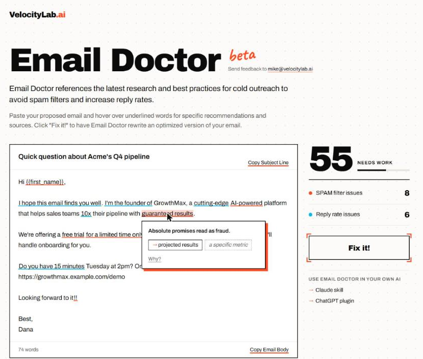

<p align="center">
  
</p>

<h1 align="center">Email Doctor</h1>

<p align="center">
  Check a cold email for spam-filter triggers and reply-rate problems, see why each phrase is flagged, and get a cleaner rewrite.<br>
  Works as a <b>ChatGPT plugin</b> and a <b>Claude skill</b>. Try it in your browser at <a href="https://velocitylab.ai/emaildoctor/">velocitylab.ai/emaildoctor</a>.
</p>

<p align="center">
  
</p>

## What it does

- **Scores your email from 0 to 100** against 405 phrases drawn from SpamAssassin rules, mailbox provider guidelines, and published deliverability studies.
- **Explains every flag.** Issues are sorted into SPAM filter issues and reply rate issues, each with the reason it's flagged, its source, and a suggested fix.
- **Rewrites the email** into a short, specific version: a 1 to 4 word subject, 50 to 100 words, the reader's problem first, and one low-pressure ask. It keeps your real facts and never invents results.
- **Re-checks the rewrite** and shows how the score changed.

## Install

### ChatGPT

1. Download [**email-doctor-plugin.zip**](https://github.com/michaeljpenrod/email-doctor/raw/main/chatgpt/email-doctor-plugin.zip).
2. In ChatGPT, open **Plugins**, click **Add**, and choose **Upload plugin archive**.
3. Select the zip, click **Add plugin**, then **Install plugin**.

### Claude

1. Download [**email-doctor-skill.zip**](https://github.com/michaeljpenrod/email-doctor/raw/main/email-doctor-skill.zip).
2. In Claude, open **Settings → Capabilities**, make sure code execution is on, and upload the zip under **Skills**.

### Claude Code

Copy the skill folder into your skills directory:

```bash
git clone https://github.com/michaeljpenrod/email-doctor.git
cp -r email-doctor/claude/email-doctor ~/.claude/skills/
```

## Use it

Paste a cold email and ask Email Doctor to check it or fix it. In ChatGPT, start your message with **@email-doctor**.

```
@email-doctor Check this cold email:

Subject: Quick question about Acme's Q4 pipeline

Hi {{first_name}},
I hope this email finds you well. I'm the founder of GrowthMax, a cutting-edge
AI-powered platform that helps sales teams 10x their pipeline with guaranteed results...
```

You get a score and a list of issues:

```
Score: 55/100 (Needs work) · 74 words
8 SPAM filter issues · 6 reply rate issues

SPAM filter issues
- "guaranteed results" (Overpromise): absolute promises read as fraud. Fix: a specific result.
- "for a limited time only" (Urgency): pressure reads as a mass blast. Fix: available through [date].
- ...

Reply rate issues
- "I hope this email finds you well" (Cliché): readers skim past it. Fix: delete it.
- ...
```

Ask it to fix the email and it returns a ready-to-send subject and body, then shows the new score, for example "Score changed from 55 → 94".

## How scoring works

Each flagged phrase has a severity. Phishing-style and deceptive phrases weigh the most, then money claims and guarantees, then urgency and promotional language. Clichés and hype count least, because they cost replies more than they trip filters. A phrase in the subject line counts double, and several serious phrases together count extra. Formatting problems such as stacked exclamation marks, hidden characters, and shortened links are scored too.

Wording is only part of deliverability. Sender reputation, SPF/DKIM/DMARC, and daily sending volume matter as much or more. The [research notes](claude/email-doctor/references/research.md) cover what filters actually weigh, the reply-rate data behind each rewrite rule, and a pre-send checklist.

## Run the checker on its own

The checker is a single Python script with no dependencies (Python 3.8+):

```bash
python claude/email-doctor/scripts/email_doctor.py --file email.txt
```

Start `email.txt` with a `Subject: ...` line, or pass `--subject` and `--body`. Add `--json` for machine-readable output.

## What's in this repository

| Path | Contents |
|---|---|
| `chatgpt/email-doctor-plugin.zip` | The ChatGPT plugin |
| `email-doctor-skill.zip` | The Claude skill, packaged for upload |
| `claude/email-doctor/` | The skill itself: `SKILL.md`, the checker script, the phrase catalog, rewrite rules, and research notes |
| `chatgpt/plugin/plugin.json` | The ChatGPT plugin manifest |

## Feedback

Email Doctor is in beta. Open an [issue](https://github.com/michaeljpenrod/email-doctor/issues) or email [mike@velocitylab.ai](mailto:mike@velocitylab.ai).

## License

[MIT](LICENSE). SpamAssassin rule names and scores are cited from its Apache-2.0 rule files. Vendor lists and studies are cited by URL in the catalog and research notes.
